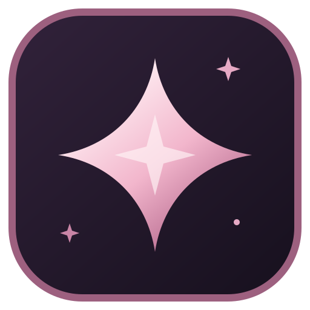
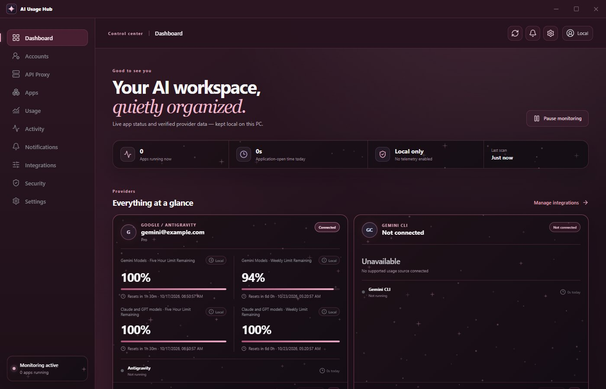
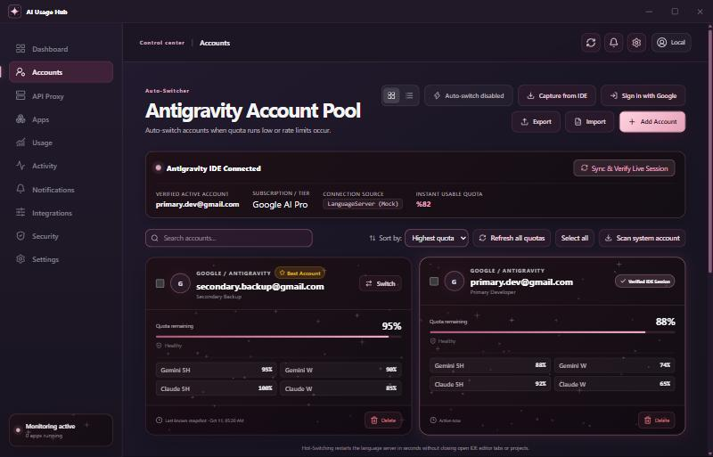
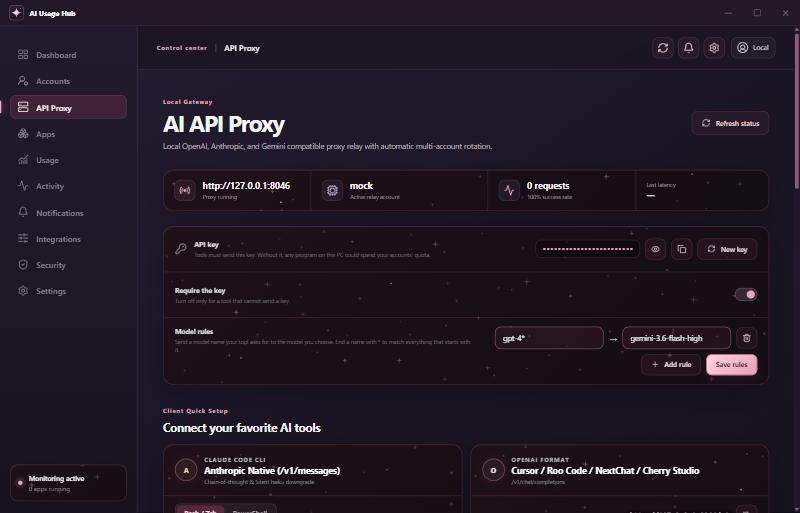
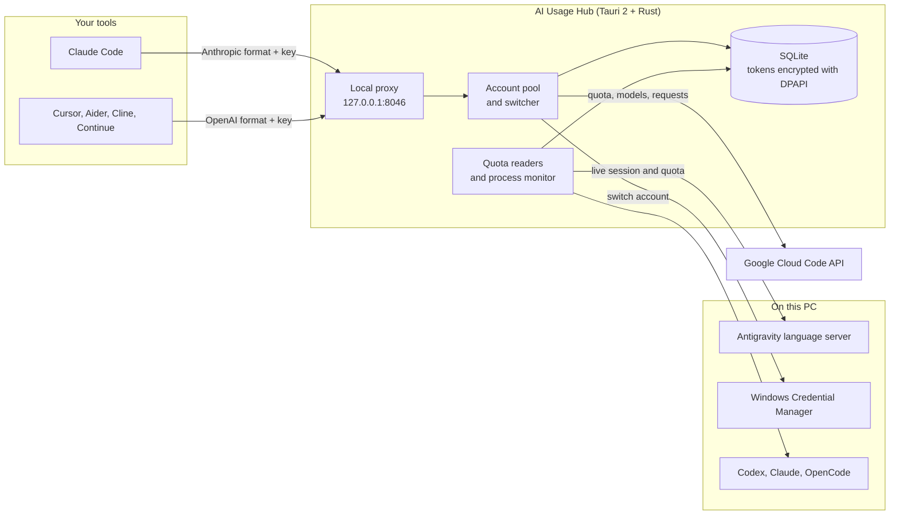

<div align="center">
  
  <h1>AI Usage Hub</h1>
  <p><strong>Local-first AI usage dashboard, Antigravity account switcher and local API proxy for Windows.</strong></p>

  <p>
    <strong>Language:</strong> <a href="README.md"><strong>EN</strong></a> | <a href="README.tr.md"><strong>TR</strong></a>
    &nbsp;•&nbsp;
    <a href="https://github.com/Hfatih/ai-usage-hub/releases/latest">Download Release</a> ·
    <a href="#connecting-tools">Connecting tools</a> ·
    <a href="#how-it-works">How it works</a> ·
    <a href="#macos-preview-macos-branch">macOS</a>
  </p>

  <p>
    
    
    
    
    
    
    
    
  </p>
</div>

---

## Overview

**AI Usage Hub** is a small Windows desktop app that shows, in one place, how much of your AI subscriptions you have left. It reads quota from the tools already signed in on your PC (Codex, Claude Code and Claude Desktop, Google Antigravity, OpenCode) and keeps everything in a local database. There is no telemetry and no account with us.

For Google Antigravity it goes further: it keeps a pool of your Google accounts, shows each one's real quota, switches the IDE between them, and can expose them to other tools through a local API proxy.

## Screenshots

| Dashboard |
| :---: |
|  |
| *Provider quotas, reset times and which AI apps are running.* |

| Antigravity account pool |
| :---: |
|  |
| *Live IDE session, per-account 5-hour and weekly quota, switching and auto-switch.* |

| Local API proxy |
| :---: |
|  |
| *Proxy address, API key, model rules and copy-paste setup for common tools.* |

Screenshots use the app's built-in preview data.

## Features

### Usage dashboard

- **ChatGPT / Codex:** shared 5-hour and weekly windows with reset times, read from the signed-in Codex app.
- **Claude Desktop / Claude Code:** shared 5-hour and weekly quota and local token totals.
- **Google Antigravity:** Gemini and Claude/GPT quota windows, the Google One AI credit balance, and Antigravity's prompt and flow credits.
- **OpenCode:** connected providers, the free model catalog and local token and cost totals.
- **Gemini CLI:** remaining quota per model, read with the CLI's own Google sign-in.
- **GitHub Copilot:** chat, completion and premium request quotas, read with the editor plugin's sign-in.
- **Cursor:** included and on-demand usage for the billing cycle, read with Cursor's own session (written from the endpoint's known shape; not yet tested against a live Cursor install).
- **DeepSeek, Kimi / Moonshot, Grok / xAI:** paste an API key on the Integrations page. DeepSeek and Kimi show the account balance; xAI reports no balance for a regular key, so Grok shows only whether the key works.
- Cards and accounts are grouped by provider, Google first.
- Every value is labeled *Official*, *Local*, *Calculated* or *Unavailable*. The app does not show a number it could not read.
- Local alerts when a quota drops below your thresholds, with optional Windows notifications.
- Tracks how long each AI app has been open today and this week.

### Antigravity account pool

- **Live session detection:** asks the running Antigravity language server which account is signed in; falls back to Windows Credential Manager and Antigravity's local state when the IDE is closed.
- **Real quota for every account:** each pooled account's 5-hour and weekly windows, with reset times, refreshed from Google every ten minutes.
- **Account switching:** writes the chosen account's sign-in to Windows Credential Manager and restarts Antigravity's language server. The hub then checks which account the IDE reports; if it is still the old one, it restores the previous sign-in and tells you.
- **Auto-switch:** moves to another healthy account when the current one falls below your threshold or gets rate limited.
- **Add accounts** with Google sign-in in the browser, by capturing the account currently signed in to the IDE, or by importing JSON.
- **Batch delete**, search, sort (including by Gemini or Claude/GPT quota), grid and list views, JSON export and import.
- **Plan-aware:** shows each account's plan and can prefer Ultra accounts before Pro before Free.
- **Per-account proxy:** route one account's Google traffic through its own HTTP or SOCKS5 proxy. If that proxy is down the request fails instead of going out directly.
- **Close or force-close** the Antigravity IDE from the app.

### Local API proxy (`http://127.0.0.1:8046`)

- **Three API formats:** OpenAI (`/v1/chat/completions`), Anthropic (`/v1/messages`) and Gemini (`/v1beta/models/...:generateContent`).
- **Image generation:** OpenAI Images format (`/v1/images/generations`) with `size`, `quality`, `imageSize`, `n` (1-10) and `response_format` (`b64_json` or `url`). A model suffix such as `-16-9-4k` sets ratio and resolution too.
- **Live model list:** `/v1/models` and the test panel show the models your account can actually call, read from Google. Real model ids pass through unchanged; familiar names such as `claude-3-7-sonnet` or `gpt-4o` are mapped to the current equivalent.
- **Model rules:** send any model name a tool asks for to a model you choose (`gpt-4*` → a Gemini model, for example). A rule starting with `re:` is a regular expression.
- **API key:** the proxy rejects requests without the key shown in the app. It listens on `127.0.0.1` only.
- **Failover:** on a 429 or 403 the proxy marks the account and retries with the next healthy one. This rotation is the proxy's own; it does not switch the account open in the IDE.
- **Background downgrade:** Haiku-class requests, and conversation-title or next-prompt-suggestion requests whatever model they name, go to a Flash model to save Claude quota. Can be turned off.
- **Port and timeout** are configurable; a new port applies after a restart.
- **One-click connect** for Claude Code and OpenCode: writes the proxy address and key into the tool's own config file, keeps a `.hub-backup` copy and can remove its entries again.
- **Risk notice:** the proxy answers 403 until you accept the notice below in the app.

Limits worth knowing: streaming responses are delivered as a single chunk rather than token by token, and `n` images cost `n` upstream requests.

> [!WARNING]
> Using pooled Google accounts through a local proxy may violate Google's Terms of Service and could get an account suspended. The usage dashboard does not need the proxy; use the proxy at your own risk.

## How it works



## Connecting tools

Copy the API key from **API Proxy** in the app and use it wherever `YOUR_KEY` appears. The app shows these snippets with your key already filled in.

**Claude Code**

```powershell
$env:ANTHROPIC_BASE_URL="http://127.0.0.1:8046"
$env:ANTHROPIC_API_KEY="YOUR_KEY"
claude
```

**Cursor, Roo Code, Cherry Studio and other OpenAI-compatible tools**

- Base URL: `http://127.0.0.1:8046/v1`
- API key: `YOUR_KEY`
- Model: any id from the app's model list, or a familiar name such as `claude-3-7-sonnet`

**Aider**

```powershell
$env:OPENAI_API_BASE="http://127.0.0.1:8046/v1"
$env:OPENAI_API_KEY="YOUR_KEY"
aider --model openai/claude-3-7-sonnet
```

**Image generation**

```powershell
curl http://127.0.0.1:8046/v1/images/generations -H "Authorization: Bearer YOUR_KEY" -H "Content-Type: application/json" -d '{\"prompt\": \"a pink star on a dark background\"}'
```

## Download and installation

1. Download the Windows installer from the [latest release](https://github.com/Hfatih/ai-usage-hub/releases/latest).
2. Run it. It installs for the current Windows user and does not need administrator rights.
3. Start **AI Usage Hub**. Accounts appear once the matching tool is signed in on this PC.
4. Turkish is available under **Settings → Language**.

> [!NOTE]
> Windows 10/11 and Microsoft Edge WebView2 are required. The installer is not code-signed, so Windows SmartScreen may warn on first run; each release lists a SHA-256 checksum you can compare. There is no auto-update: install a newer release over the old one.

Upgrading from 0.1.21 or earlier: the proxy now requires an API key. Tools configured with the old placeholder key need the new key from the API Proxy page.

## Building from source

Requirements: Windows 10/11 x64, [Node.js](https://nodejs.org/) 20+, the [Rust MSVC toolchain](https://rustup.rs/) and Microsoft C++ Build Tools.

```powershell
git clone https://github.com/Hfatih/ai-usage-hub.git
cd ai-usage-hub
npm ci
npm run tauri dev
```

Production installer (written to `src-tauri/target/release/bundle/nsis/`):

```powershell
npm run tauri build
```

Tests:

```powershell
npm test
npm run build
cd src-tauri
cargo test --locked
```

## macOS (preview, `macos` branch)

This branch contains a native Mac port of the same app. **There is no published macOS release yet.** The Mac-specific code compiles and its unit tests run on macOS in CI, but some integrations below have not yet been confirmed against the real apps on a Mac; please report what you see.

| Area | Windows | macOS |
| --- | --- | --- |
| Database | `%APPDATA%\com.aiusagehub.desktop\` | `~/Library/Application Support/com.aiusagehub.desktop/` |
| Logs | `%LOCALAPPDATA%\AI Usage Hub\` | `~/Library/Logs/AI Usage Hub/` |
| Pool token encryption | DPAPI | ChaCha20-Poly1305, key in the login Keychain (`com.aiusagehub.desktop` / `token-encryption-key`) |
| Antigravity sign-in (switching) | Credential Manager `gemini:antigravity` | Keychain item, service `gemini`, account `antigravity` |
| Claude Desktop, Antigravity data | `%APPDATA%\Claude`, `%APPDATA%\Antigravity` | `~/Library/Application Support/Claude`, `.../Antigravity` |
| App detection and launch | `.exe` names and install folders | Process names and `.app` bundles in `/Applications` and `~/Applications`, opened through Launch Services |
| Command-line tools | `PATH` | `PATH` plus Homebrew, npm, `~/.local/bin`, which Finder-launched apps do not inherit |
| Window | Custom title bar | Native traffic lights; closing hides to the menu bar, the Dock icon brings it back |
| Start at login | Registry run key | Login item (LaunchAgent) |

Not yet verified on a Mac: that Antigravity's macOS build keeps its sign-in in the `gemini` / `antigravity` Keychain item (the format matches the Go keyring library its language server uses), and where the Codex app ships its CLI. Antigravity's local port is read from its language-server log, or, when that log is not found, from the ports the language server listens on (`lsof`).

### Build on a Mac

Requirements: macOS 11 or later, Xcode Command Line Tools (`xcode-select --install`), [Node.js](https://nodejs.org/) 20+ and [Rust](https://rustup.rs/).

```bash
git clone -b macos https://github.com/Hfatih/ai-usage-hub.git
cd ai-usage-hub
npm ci
npm run tauri dev                         # run from source
npm run tauri build -- --bundles app,dmg  # writes src-tauri/target/release/bundle/{macos,dmg}/
```

Each push to this branch also builds a `.dmg` for Apple Silicon in GitHub Actions (artifact `ai-usage-hub-macos-dmg`). Builds are ad-hoc signed, not notarized: open the app once with right-click → **Open**, or run `xattr -dr com.apple.quarantine "/Applications/AI Usage Hub.app"`. The first token encryption creates a Keychain item through `/usr/bin/security`; no password prompt is expected.

## Data and security

- **Where data lives:** `%APPDATA%\com.aiusagehub.desktop\ai-usage-hub.sqlite3` (macOS: `~/Library/Application Support/com.aiusagehub.desktop/`), on this computer only.
- **No passwords:** the app never asks for or stores a Google, OpenAI or Anthropic password.
- **Sign-in tokens:** Codex and Claude keep their own credentials; the hub stores only labels and usage for them. For Antigravity pool accounts it stores Google OAuth tokens, encrypted with Windows DPAPI for your Windows user (on macOS, with a key kept in your login Keychain). A copied database cannot be read under another user.
- **Exports:** an exported account JSON contains the tokens in plain text. Treat it like a password.
- **API keys and account proxies:** provider API keys you paste and per-account proxy addresses are stored the same way, encrypted with DPAPI, and a key is sent only to its own provider.
- **Proxy:** listens on `127.0.0.1` only and requires the API key unless you turn that off.
- **No telemetry:** the app talks only to the providers' own endpoints.
- The **Security** page in the app shows what is stored and lets you clear usage history. To report a vulnerability, see [SECURITY.md](SECURITY.md).

## License and disclaimer

Released under the [MIT License](LICENSE).

AI Usage Hub is an independent open-source project and is not affiliated with Google, OpenAI or Anthropic. It relies on undocumented local and internal interfaces that can change without notice. Product names are trademarks of their respective owners.
