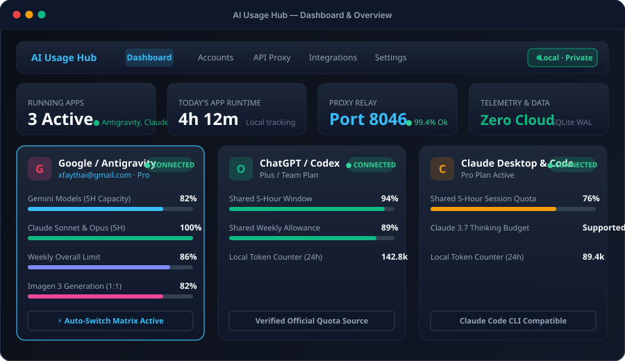
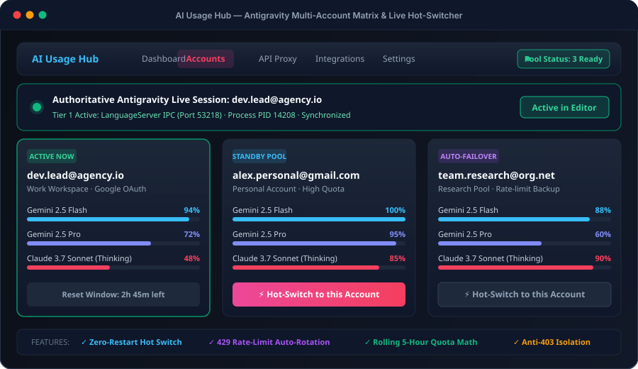
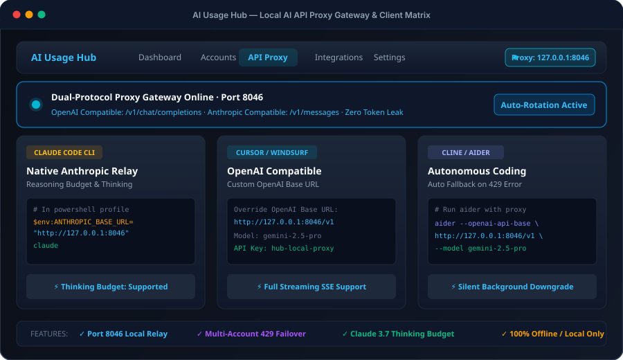
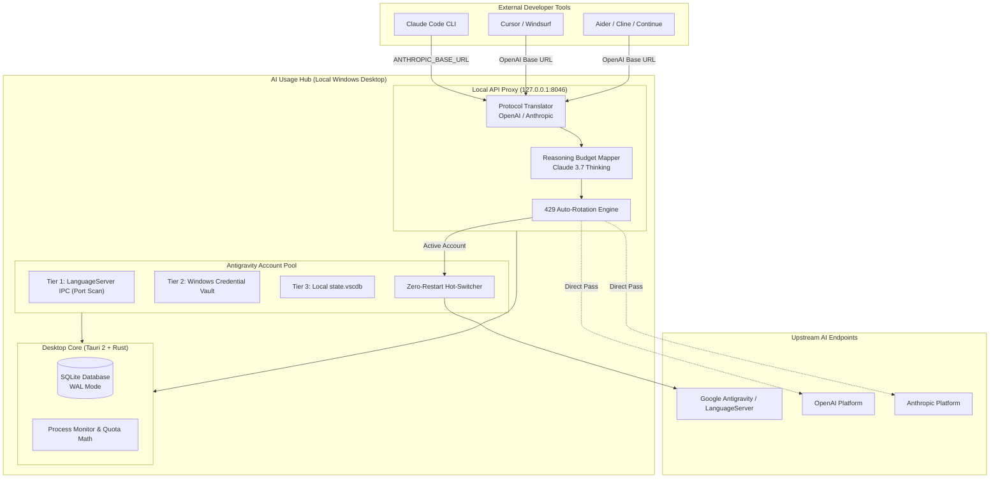

<div align="center">
  
  <h1>AI Usage Hub</h1>
  <p><strong>The Private Multi-Provider AI Cockpit, Local API Gateway &amp; Zero-Restart Antigravity Session Switcher for Windows.</strong></p>

  <p>
    <strong>Language:</strong> <a href="README.md"><strong>EN</strong></a> | <a href="README.tr.md"><strong>TR</strong></a>
    &nbsp;•&nbsp;
    <a href="https://github.com/Hfatih/ai-usage-hub/releases/latest">Download Release</a> ·
    <a href="#-quick-client-presets">Client Presets</a> ·
    <a href="#-architecture">Architecture</a> ·
    <a href="#-support--sponsorship">Buy Me a Coffee</a>
  </p>

  <p>
    
    
    
    
    
    
    
    
  </p>
</div>

---

## ☕ Support & Sponsorship

If **AI Usage Hub** saves you subscription headaches, unlocks unlimited coding workflows, or prevents quota lockouts, consider supporting its active development:

<div align="center">
  <a href="https://buymeacoffee.com/hfatih" target="_blank">
    
  </a>
  &nbsp;&nbsp;
  <a href="https://github.com/sponsors/Hfatih" target="_blank">
    
  </a>
  <p><sub><em>Your support keeps the project independent, free, and continuously updated with provider changes.</em></sub></p>
</div>

---

## 🚀 Overview

**AI Usage Hub** is a lightweight, local-first Windows companion designed for developers and AI power users. It unifies provider quotas, active sessions, runtime analytics, and multi-account rotation into one clean dashboard.

It also embeds a **high-performance local AI API Gateway** (`http://127.0.0.1:8046`), allowing your favorite external development tools (**Claude Code CLI, Cursor, Windsurf, Aider, Cline, Continue.dev**) to seamlessly leverage your existing AI accounts with automatic rate-limit failover, native reasoning budget management, and zero token leakage.

---

## 📸 Visual Tour

| **Dashboard & Runtime Analytics** |
| :---: |
|  |
| *Real-time app runtimes, rolling 5-hour quota windows, and active process tracking.* |

| **Antigravity Multi-Account Matrix & Hot-Switcher** |
| :---: |
|  |
| *Authoritative 3-tier live session detection, zero-restart instant hot-switching, and 429 failover.* |

| **Local AI API Gateway (`127.0.0.1:8046`)** |
| :---: |
|  |
| *Dual-protocol relay (OpenAI + Anthropic), Claude 3.7 reasoning budget support, and client presets.* |

---

## ✨ Key Features

### ⚡ Antigravity Multi-Account Matrix & Live Hot-Switcher
- **Authoritative 3-Tier Live Session Detection:** Identifies the active Google Antigravity account using LanguageServer IPC process ports (Tier 1), Windows Credential Manager tokens (Tier 2), and `state.vscdb` local databases (Tier 3). Never shows a false or stale account.
- **Zero-Restart Instant Hot-Switching:** Switch between work, personal, and research accounts on the fly without closing your IDE. Cleans stale LanguageServer instances automatically (`kill_antigravity_language_servers`).
- **Rolling 5-Hour Sliding Window Quota Math:** Accurately computes remaining Gemini and Claude quotas based on sliding timestamps, completely eliminating the common false 0% lock bug.
- **Official Google OAuth 2.0 Integration:** Secure browser-based OAuth flow on local port `8045` for official token provisioning.
- **Auto-Rotation on 429 Rate Limits:** Automatically routes API requests to standby accounts in your pool when rate limits are triggered.
- **Encrypted Local Storage:** All account credentials and cookies are sealed locally using Windows DPAPI / AES-256-GCM.

### 🌐 High-Performance Local AI API Gateway (`127.0.0.1:8046`)
- **Dual-Protocol Compatibility:** Seamlessly exposes both:
  - `POST /v1/chat/completions` (OpenAI format for Cursor, Windsurf, Aider)
  - `POST /v1/messages` (Anthropic format for Claude Code CLI)
- **Claude 3.7 Sonnet Reasoning Budget:** Full support for extended thinking parameters (`thinkingConfig.thinkingBudget`).
- **Silent Background Downgrading:** Automatically downgrades background indexing and routine tasks to lightweight models (e.g. Gemini 2.5 Flash) to conserve high-tier quota.
- **Full Server-Sent Events (SSE) Streaming:** Ultra-low latency token streaming and keep-alive connection pooling.
- **100% Offline Relay:** Relays directly between your local editor and upstream endpoints; no intermediate cloud servers or analytics.

### 📊 Multi-Provider AI Command Center
- **ChatGPT & OpenAI Codex:** Shared 5-hour and weekly quota meters, reset countdowns, plan tiers, and local token counters.
- **Claude Desktop & Claude Code CLI:** Local plan history tracking, live app process states, and device-wide token statistics.
- **Google Antigravity:** Real-time Gemini 2.5 Pro / Flash and Claude 3.7 Sonnet quota windows.
- **OpenCode & Community Tools:** Local session metrics, catalog mapping, and process health checks.

### 🔒 100% Local-First & Zero Telemetry
- **Zero Telemetry:** No tracking, no crash telemetry, and no remote analytic beacons.
- **Local SQLite Database (`ai-usage-hub.sqlite3`):** Every snapshot, account label, and runtime session stays encrypted in `%APPDATA%\com.aiusagehub.desktop\`.
- **Integrity Verified:** Prominently labels metrics as *Official*, *Local*, *Calculated*, or *Unavailable* so you always know data authenticity.

---

## 🏗️ Architecture



---

## 🛠️ Quick Client Presets

Configure your external development tools to use AI Usage Hub's local API gateway (`http://127.0.0.1:8046`):

### 1. Claude Code CLI
In PowerShell or command prompt:
```powershell
$env:ANTHROPIC_BASE_URL = "http://127.0.0.1:8046"
$env:ANTHROPIC_API_KEY = "hub-local-proxy"
claude
```
> *Claude 3.7 Sonnet reasoning budget and thinking tokens are automatically virtualized and mapped.*

### 2. Cursor & Windsurf
1. Navigate to **Cursor Settings** → **Models** (or Windsurf Model Settings).
2. Set **Override OpenAI Base URL** to:
   ```
   http://127.0.0.1:8046/v1
   ```
3. Enter API Key: `hub-local-proxy`.
4. Enable models: `gemini-2.5-pro`, `gemini-2.5-flash`, `claude-3-7-sonnet`.

### 3. Aider (Terminal AI Pair Programmer)
Run Aider pointing to the local proxy:
```powershell
aider --openai-api-base http://127.0.0.1:8046/v1 --openai-api-key hub-local-proxy --model gemini-2.5-pro
```

### 4. Cline / Roo Code (VS Code Extension)
1. In Cline Settings, select API Provider: **OpenAI Compatible**.
2. **Base URL**: `http://127.0.0.1:8046/v1`
3. **API Key**: `hub-local-proxy`
4. **Model ID**: `gemini-2.5-pro` (or `claude-3-7-sonnet`)

---

## 📥 Download and Installation

1. Download the Windows installer (`AI-Usage-Hub-Setup-x64.exe`) from the [Latest Release](https://github.com/Hfatih/ai-usage-hub/releases/latest).
2. Run the installer. It installs strictly for the current Windows user without requiring administrator permissions.
3. Launch **AI Usage Hub** and connect your existing local accounts.
4. *(Optional)* Switch to Turkish at any time via **Settings → Language**.

> [!NOTE]
> Windows 10/11 and Microsoft Edge WebView2 (preinstalled on modern Windows) are required. Since current binaries are community-signed, Windows Defender SmartScreen may display an initial prompt. You can verify SHA-256 hashes on the Releases page.

---

## 🔨 Building from Source

### Prerequisites
- Windows 10/11 (x64)
- [Node.js](https://nodejs.org/) v20+
- [Rust MSVC toolchain](https://rustup.rs/) (stable)
- Microsoft Visual C++ Build Tools (Desktop development with C++)

### Development Mode
```powershell
# Clone the repository
git clone https://github.com/Hfatih/ai-usage-hub.git
cd ai-usage-hub

# Install dependencies
npm ci

# Start the Tauri development app
npm run tauri dev
```

### Production Build
To generate a production-ready NSIS installer:
```powershell
npm run tauri build
```
The compiled installer will be available at:
`src-tauri/target/release/bundle/nsis/`

### Running Tests
```powershell
# Run frontend unit tests
npm test

# Verify frontend production build
npm run build

# Run Rust backend test suite
cd src-tauri
cargo test --locked
```

---

## 📁 Data Storage & Security

- **Database Path:** `%APPDATA%\com.aiusagehub.desktop\ai-usage-hub.sqlite3`
- **Zero Passwords:** AI Usage Hub never requests or stores raw Google or OpenAI account passwords.
- **DPAPI Encryption:** Token secrets are encrypted with the Windows Data Protection API (DPAPI).
- For complete vulnerability reporting procedures, see [SECURITY.md](SECURITY.md).

---

## 📄 License & Disclaimer

Released under the [MIT License](LICENSE).

*AI Usage Hub is an independent open-source project. Google Antigravity, OpenAI ChatGPT, Anthropic Claude, Cursor, and other named products are trademarks of their respective owners.*
