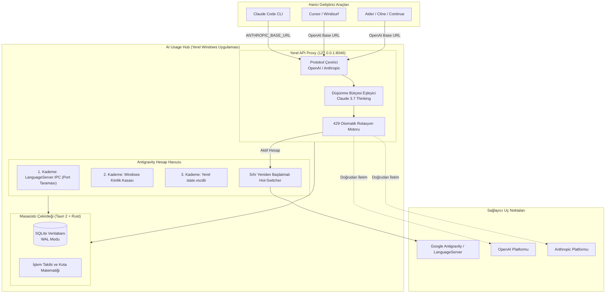

<div align="center">
  
  <h1>AI Usage Hub</h1>
  <p><strong>Windows İçin Gizlilik Odaklı Çoklu Yapay Zekâ Kontrol Merkezi, Yerel API Ağ Geçidi ve Sıfır Yeniden Başlatmalı Antigravity Hesap Yöneticisi.</strong></p>

  <p>
    <strong>Dil:</strong> <a href="README.tr.md"><strong>TR</strong></a> | <a href="README.md"><strong>EN</strong></a>
    &nbsp;•&nbsp;
    <a href="https://github.com/Hfatih/ai-usage-hub/releases/latest">Sürümü İndir</a> ·
    <a href="#-hızlı-istemci-kurulumları">İstemci Ayarları</a> ·
    <a href="#-mimari">Mimari</a> ·
    <a href="#-destek-ve-sponsorluk">Kahve Ismarla</a>
  </p>

  <p>
    
    
    
    
    
    
    
    
  </p>
</div>

---

## ☕ Destek ve Sponsorluk

Eğer **AI Usage Hub** abonelik karmaşanı çözüyor, geliştirme iş akışını hızlandırıyor veya kota kilitlenmelerini önlüyorsa, projeyi destekleyebilir ve bir kahve ısmarlayabilirsin:

<div align="center">
  <a href="https://buymeacoffee.com/hfatih" target="_blank">
    
  </a>
  &nbsp;&nbsp;
  <a href="https://github.com/sponsors/Hfatih" target="_blank">
    
  </a>
  <p><sub><em>Desteğin sayesinde proje tamamen bağımsız, ücretsiz ve sağlayıcı güncellemelerine karşı daima güncel kalır.</em></sub></p>
</div>

---

## 🚀 Genel Bakış

**AI Usage Hub**, yazılımcılar ve yapay zekâ profesyonelleri için geliştirilmiş hafif ve tamamen yerel çalışan bir Windows uygulamasıdır. Sağlayıcı kotalarını, aktif oturumları, çalışma süresi analizlerini ve çoklu hesap geçişlerini tek bir modern panelde birleştirir.

Uygulama ayrıca bünyesinde **yüksek performanslı yerel bir AI API Ağ Geçidi** (`http://127.0.0.1:8046`) barındırır. Bu sayede harici geliştirme araçların (**Claude Code CLI, Cursor, Windsurf, Aider, Cline, Continue.dev**), mevcut yapay zekâ hesaplarını otomatik 429 kota rotasyonu, yerel düşünme bütçesi (reasoning budget) yönetimi ve sıfır veri sızıntısıyla doğrudan kullanabilir.

---

## 📸 Görsel Tur

| **Genel Panel ve Çalışma Süresi Analitiği** |
| :---: |
|  |
| *Gerçek zamanlı uygulama çalışma süreleri, kayan 5 saatlik kota pencereleri ve aktif işlem takibi.* |

| **Antigravity Çoklu Hesap Havuzu ve Canlı Geçiş Sistemi** |
| :---: |
|  |
| *3 kademeli otoriter canlı oturum algılama, IDE kapatmadan anında hot-switch ve 429 kota rotasyonu.* |

| **Yerel AI API Ağ Geçidi (`127.0.0.1:8046`)** |
| :---: |
|  |
| *Çift protokol desteği (OpenAI + Anthropic), Claude 3.7 reasoning bütçesi ve hazır istemci şablonları.* |

---

## ✨ Temel Özellikler

### ⚡ Antigravity Çoklu Hesap Havuzu ve Canlı Hot-Switch
- **3 Kademeli Otoriter Canlı Oturum Tespiti:** Aktif Google Antigravity hesabını LanguageServer IPC işlem portları (1. Kademe), Windows Kimlik Bilgisi Yöneticisi (2. Kademe) ve `state.vscdb` yerel veritabanları (3. Kademe) ile eşzamanlı doğrular. Asla eski veya yanlış hesap bilgisi göstermez.
- **Sıfır Yeniden Başlatmalı Anında Hesap Geçişi (Hot-Switch):** Editörünü veya IDE'ni kapatmana gerek kalmadan iş, kişisel ve test hesapların arasında tek tıkla geçiş yap. Arka plandaki eski LanguageServer süreçlerini otomatik temizler (`kill_antigravity_language_servers`).
- **Kayan 5 Saatlik Kota Matematiği:** Gemini ve Claude kotalarını kayan zaman damgalarıyla doğru hesaplar; kullanıcıları mağdur eden sahte %0 kota kilitlenmesi sorununu kökten çözer.
- **Resmî Google OAuth 2.0 Desteği:** Yerel `8045` portu üzerinden güvenli ve tarayıcı tabanlı OAuth yetkilendirmesi.
- **429 Hata Anında Otomatik Hesap Rotasyonu:** Bir hesap saatlik istek sınırına ulaştığında (429 Too Many Requests), istekleri havuzdaki yedek hesaba sessizce ve kesintisiz devreder.
- **Şifrelenmiş Yerel Depolama:** Tüm oturum belirteçleri Windows DPAPI / AES-256-GCM ile bilgisayarında yerel olarak mühürlenir.

### 🌐 Yüksek Performanslı Yerel AI API Ağ Geçidi (`127.0.0.1:8046`)
- **Çift Protokol Uyumluluğu:** İki popüler standardı da yerel olarak sunar:
  - `POST /v1/chat/completions` (Cursor, Windsurf ve Aider için OpenAI standardı)
  - `POST /v1/messages` (Claude Code CLI için Anthropic standardı)
- **Claude 3.7 Sonnet Düşünme Bütçesi (Reasoning Budget):** Gelişmiş düşünme parametrelerini (`thinkingConfig.thinkingBudget`) tam uyumlulukla karşılar ve modeller arası haritalandırır.
- **Sessiz Arka Plan İndirgemesi:** Kod indeksleme veya rutin arka plan görevlerini otomatik olarak hafif modellere (örn. Gemini 2.5 Flash) yönlendirerek ana kotanın erken tükenmesini engeller.
- **Gerçek Zamanlı SSE Token Akışı (Streaming):** Düşük gecikmeli token akışı ve canlı bağlantı havuzu.
- **%100 Çevrimdışı ve Yerel İletim:** Doğrudan yerel geliştirme aracın ile hedef uç noktası arasında çalışır; aracı sunucu, bulut analitiği veya telemetri içermez.

### 📊 Çoklu Sağlayıcı AI Komuta Merkezi
- **ChatGPT & OpenAI Codex:** Ortak 5 saatlik ve haftalık kota çubukları, geri sayım sayaçları, plan seviyeleri ve yerel token istatistikleri.
- **Claude Desktop & Claude Code CLI:** Yerel plan geçmişi takibi, canlı işlem durumları ve cihaz genelindeki token sayaçları.
- **Google Antigravity:** Gemini 2.5 Pro / Flash ve Claude 3.7 Sonnet kotaları anlık izleme.
- **OpenCode & Topluluk Araçları:** Yerel oturum kayıtları, model eşleştirmeleri ve süreç sağlık kontrolleri.

### 🔒 %100 Gizlilik ve Yerel Mimari
- **Sıfır Telemetri:** Hiçbir kullanıcı verisi, çökme kaydı veya kullanım telemetrisi toplanmaz ve harici sunuculara iletilmez.
- **Yerel SQLite Veritabanı (`ai-usage-hub.sqlite3`):** Tüm veriler WAL modunda `%APPDATA%\com.aiusagehub.desktop\` dizininde yerel olarak saklanır.
- **Doğrulanmış Veri Kaynakları:** Değerler *Resmî*, *Yerel*, *Hesaplanan* veya *Kullanılamıyor* etiketleriyle sunulur; asla uydurma kota gösterilmez.

---

## 🏗️ Mimari



---

## 🛠️ Hızlı İstemci Kurulumları

Harici geliştirme araçlarını AI Usage Hub yerel API ağ geçidine (`http://127.0.0.1:8046`) bağlamak için aşağıdaki ayarları kullanabilirsin:

### 1. Claude Code CLI
PowerShell veya komut satırında ortam değişkenlerini tanımla:
```powershell
$env:ANTHROPIC_BASE_URL = "http://127.0.0.1:8046"
$env:ANTHROPIC_API_KEY = "hub-local-proxy"
claude
```
> *Claude 3.7 Sonnet düşünme bütçesi ve mantık yürütme tokenları yerel olarak otomatik dönüştürülür.*

### 2. Cursor ve Windsurf
1. **Cursor Ayarları** → **Models** (veya Windsurf Model Ayarları) sekmesine git.
2. **Override OpenAI Base URL** alanını şu şekilde ayarla:
   ```
   http://127.0.0.1:8046/v1
   ```
3. API Anahtarı olarak `hub-local-proxy` gir.
4. İstediğin modelleri etkinleştir: `gemini-2.5-pro`, `gemini-2.5-flash`, `claude-3-7-sonnet`.

### 3. Aider (Terminal Yapay Zekâ Eş Programcısı)
Aider'ı yerel proxy üzerinden başlat:
```powershell
aider --openai-api-base http://127.0.0.1:8046/v1 --openai-api-key hub-local-proxy --model gemini-2.5-pro
```

### 4. Cline / Roo Code (VS Code Eklentisi)
1. Cline ayarlarında API Sağlayıcısı olarak **OpenAI Compatible** seç.
2. **Base URL**: `http://127.0.0.1:8046/v1`
3. **API Key**: `hub-local-proxy`
4. **Model ID**: `gemini-2.5-pro` (veya `claude-3-7-sonnet`)

---

## 📥 İndir ve Kur

1. [En Son Sürüm](https://github.com/Hfatih/ai-usage-hub/releases/latest) sayfasından Windows kurulum paketini (`AI-Usage-Hub-Setup-x64.exe`) indir.
2. Kurulumu çalıştır. Yalnızca mevcut Windows kullanıcısına kurulur; yönetici izni gerekmez.
3. **AI Usage Hub**'ı başlat ve yerel hesaplarını bağla.
4. Dilediğin zaman **Settings → Language** bölümünden Türkçe veya İngilizce arasında geçiş yapabilirsin.

> [!NOTE]
> Windows 10/11 ve Microsoft Edge WebView2 gereklidir. Henüz dijital olarak açık kaynak topluluk imzalı olduğu için Windows SmartScreen ilk açılışta onay uyarısı verebilir. Releases sayfasındaki SHA-256 sağlama toplamını doğrulayabilirsin.

---

## 🔨 Kaynaktan Derleme

### Gereksinimler
- Windows 10/11 (x64)
- [Node.js](https://nodejs.org/) v20+
- [Rust MSVC araç zinciri](https://rustup.rs/) (kararlı sürüm)
- Microsoft Visual C++ Build Tools (C++ ile masaüstü geliştirme paketi)

### Geliştirici Modunda Çalıştırma
```powershell
# Depoyu klonla
git clone https://github.com/Hfatih/ai-usage-hub.git
cd ai-usage-hub

# Paket bağımlılıklarını kur
npm ci

# Tauri geliştirici uygulamasını başlat
npm run tauri dev
```

### Kurulum Paketi (NSIS) Oluşturma
Üretim için imzalı/imzasız Windows kurulum paketi üretmek için:
```powershell
npm run tauri build
```
Oluşturulan kurulum dosyası şurada yer alır:
`src-tauri/target/release/bundle/nsis/`

### Testleri Çalıştırma
```powershell
# Ön yüz birim testleri
npm test

# Ön yüz derleme kontrolü
npm run build

# Rust arka uç test paketi
cd src-tauri
cargo test --locked
```

---

## 📁 Veri Depolama ve Güvenlik

- **Veritabanı Konumu:** `%APPDATA%\com.aiusagehub.desktop\ai-usage-hub.sqlite3`
- **Sıfır Parola Saklama:** AI Usage Hub asla Google veya OpenAI gibi hesap parolalarını talep etmez ya da düz metin olarak kaydetmez.
- **DPAPI Şifrelemesi:** Oturum belirteçleri Windows Veri Koruma API'si (DPAPI) ile mühürlenir.
- Güvenlik açığı bildirim süreci için [SECURITY.md](SECURITY.md) dosyasına bakabilirsiniz.

---

## 📄 Lisans ve Yasal Uyarı

Bu proje [MIT Lisansı](LICENSE) kapsamında yayımlanmıştır.

*AI Usage Hub bağımsız bir açık kaynak topluluk projesidir. Google Antigravity, OpenAI ChatGPT, Anthropic Claude, Cursor ve adı geçen diğer ticari markalar ilgili hak sahiplerine aittir.*
