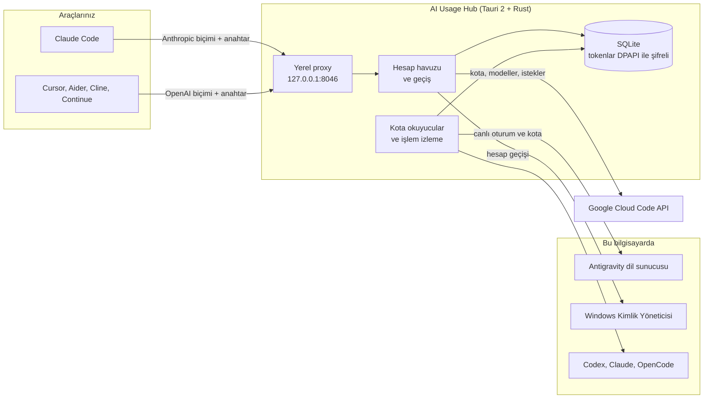

<div align="center">
  
  <h1>AI Usage Hub</h1>
  <p><strong>Windows için yerel yapay zekâ kullanım paneli, Antigravity hesap değiştirici ve yerel API proxy.</strong></p>

  <p>
    <strong>Dil:</strong> <a href="README.tr.md"><strong>TR</strong></a> | <a href="README.md"><strong>EN</strong></a>
    &nbsp;•&nbsp;
    <a href="https://github.com/Hfatih/ai-usage-hub/releases/latest">Sürümü İndir</a> ·
    <a href="#araçları-bağlama">Araçları bağlama</a> ·
    <a href="#nasıl-çalışır">Nasıl çalışır</a>
  </p>

  <p>
    
    
    
    
    
    
    
    
  </p>
</div>

---

## Genel bakış

**AI Usage Hub**, yapay zekâ aboneliklerinizden ne kadar hakkınız kaldığını tek ekranda gösteren küçük bir Windows uygulamasıdır. Kotayı bilgisayarınızda zaten oturum açmış araçlardan (Codex, Claude Code ve Claude Desktop, Google Antigravity, OpenCode) okur ve her şeyi yerel bir veritabanında tutar. Telemetri yoktur, bizde hesap açmanız gerekmez.

Google Antigravity için daha fazlasını yapar: Google hesaplarınızı bir havuzda tutar, her birinin gerçek kotasını gösterir, IDE'yi hesaplar arasında değiştirir ve bu hesapları yerel bir API proxy üzerinden başka araçlara açabilir.

## Ekran görüntüleri

| Genel bakış |
| :---: |
|  |
| *Sağlayıcı kotaları, sıfırlanma zamanları ve çalışan yapay zekâ uygulamaları.* |

| Antigravity hesap havuzu |
| :---: |
|  |
| *Canlı IDE oturumu, hesap başına 5 saatlik ve haftalık kota, geçiş ve otomatik geçiş.* |

| Yerel API proxy |
| :---: |
|  |
| *Proxy adresi, API anahtarı, model kuralları ve yaygın araçlar için hazır ayarlar.* |

Ekran görüntüleri uygulamanın yerleşik önizleme verisiyle alınmıştır (arayüz İngilizce modda).

## Özellikler

### Kullanım paneli

- **ChatGPT / Codex:** ortak 5 saatlik ve haftalık pencereler ile sıfırlanma zamanları, oturum açık Codex uygulamasından okunur.
- **Claude Desktop / Claude Code:** ortak 5 saatlik ve haftalık kota ile yerel token toplamları.
- **Google Antigravity:** Gemini ve Claude/GPT kota pencereleri, Google One AI kredi bakiyesi, Antigravity'nin prompt ve flow kredileri.
- **OpenCode:** bağlı sağlayıcılar, ücretsiz model kataloğu, yerel token ve maliyet toplamları.
- **Gemini CLI:** model başına kalan kota, CLI'nin kendi Google oturumuyla okunur.
- **GitHub Copilot:** sohbet, tamamlama ve premium istek kotaları, editör eklentisinin oturumuyla okunur.
- **Cursor:** fatura dönemindeki dahil ve ek kullanım, Cursor'ın kendi oturumuyla okunur (ucun bilinen yanıt biçimine göre yazıldı; kurulu bir Cursor ile henüz denenmedi).
- **DeepSeek, Kimi / Moonshot, Grok / xAI:** Entegrasyonlar sayfasına API anahtarı yapıştırılır. DeepSeek ve Kimi hesap bakiyesini gösterir; xAI normal anahtar için bakiye bildirmediğinden Grok yalnızca anahtarın çalışıp çalışmadığını gösterir.
- Kartlar ve hesaplar sağlayıcıya göre gruplanır, Google en üstte.
- Her değer *Resmi*, *Yerel*, *Hesaplandı* veya *Kullanılamıyor* olarak etiketlenir. Uygulama okuyamadığı bir sayıyı göstermez.
- Kota belirlediğiniz eşiğin altına düştüğünde yerel uyarı, isterseniz Windows bildirimi.
- Her yapay zekâ uygulamasının bugün ve bu hafta ne kadar açık kaldığını izler.

### Antigravity hesap havuzu

- **Canlı oturum algılama:** çalışan Antigravity dil sunucusuna hangi hesabın açık olduğunu sorar; IDE kapalıyken Windows Kimlik Yöneticisi'ne ve Antigravity'nin yerel durumuna bakar.
- **Her hesap için gerçek kota:** havuzdaki her hesabın 5 saatlik ve haftalık pencereleri, sıfırlanma zamanlarıyla, on dakikada bir Google'dan yenilenir.
- **Hesap geçişi:** seçilen hesabın girişini Windows Kimlik Yöneticisi'ne yazar ve Antigravity'nin dil sunucusunu yeniden başlatır. Ardından IDE'nin hangi hesabı bildirdiğine bakar; hâlâ eski hesapsa önceki girişi geri yükler ve bunu söyler.
- **Otomatik geçiş:** etkin hesap eşiğin altına düştüğünde veya oran sınırına takıldığında sağlıklı başka bir hesaba geçer.
- **Hesap ekleme:** tarayıcıda Google ile giriş, IDE'de açık olan hesabı yakalama veya JSON içe aktarma.
- **Toplu silme**, arama, sıralama (Gemini ya da Claude/GPT kotasına göre de), kart ve liste görünümü, JSON dışa/içe aktarma.
- **Plan bilgisi:** her hesabın planını gösterir; istenirse önce Ultra, sonra Pro, sonra Free hesaplar kullanılır.
- **Hesap başına proxy:** bir hesabın Google trafiğini kendi HTTP ya da SOCKS5 proxy'sinden geçirir. Proxy çalışmıyorsa istek doğrudan gitmez, başarısız olur.
- Antigravity IDE'sini uygulamadan **kapatma ve zorla kapatma**.

### Yerel API proxy (`http://127.0.0.1:8046`)

- **Üç API biçimi:** OpenAI (`/v1/chat/completions`), Anthropic (`/v1/messages`) ve Gemini (`/v1beta/models/...:generateContent`).
- **Görsel üretimi:** OpenAI Images biçimi (`/v1/images/generations`); `size`, `quality`, `imageSize`, `n` (1-10) ve `response_format` (`b64_json` ya da `url`) desteklenir. Model adına eklenen `-16-9-4k` gibi bir ek de oranı ve çözünürlüğü belirler.
- **Canlı model listesi:** `/v1/models` ve test paneli, hesabınızın gerçekten çağırabildiği modelleri Google'dan okuyarak gösterir. Gerçek model kimlikleri aynen geçer; `claude-3-7-sonnet` veya `gpt-4o` gibi tanıdık adlar güncel karşılığına eşlenir.
- **Model kuralları:** bir aracın istediği model adını sizin seçtiğiniz modele yönlendirir (örneğin `gpt-4*` → bir Gemini modeli). `re:` ile başlayan kural düzenli ifade olarak okunur.
- **API anahtarı:** proxy, uygulamada gösterilen anahtarı göndermeyen istekleri reddeder. Yalnızca `127.0.0.1` üzerinde dinler.
- **Yedek hesaba geçiş:** 429 veya 403 yanıtında hesabı işaretler ve sıradaki sağlıklı hesapla yeniden dener.
- **Haiku düşürme:** Haiku sınıfı model istekleri (Claude Code'un başlık üretimi gibi arka plan işleri) Claude kotasını korumak için bir Flash modeline gider.

- **Kendi rotasyonu:** proxy 429 ya da 403 alınca kendi istekleri için sıradaki sağlıklı hesaba geçer; IDE'de açık olan hesabı değiştirmez.
- **Arka plan işleri:** sohbet başlığı ve sonraki istem önerisi istekleri, hangi modeli isterse istesin Flash modeline gider. Kapatılabilir.
- **Port ve zaman aşımı** ayarlanabilir; yeni port yeniden başlatınca geçerli olur.
- **Tek tıkla bağlama:** Claude Code ve OpenCode için proxy adresini ve anahtarı aracın kendi ayar dosyasına yazar, `.hub-backup` kopyası bırakır, eklediklerini geri alabilir.
- **Risk uyarısı:** uygulamadaki uyarı kabul edilene kadar proxy isteklere 403 döner.

Bilinmesi gereken sınırlar: akış (streaming) yanıtları token token değil tek parça olarak iletilir ve `n` görsel `n` ayrı istek harcar.

> [!WARNING]
> Havuzdaki Google hesaplarını yerel bir proxy üzerinden kullanmak Google'ın Kullanım Şartları'nı ihlal edebilir ve hesabın askıya alınmasına yol açabilir. Kullanım paneli proxy'ye ihtiyaç duymaz; proxy'yi kendi sorumluluğunuzda kullanın.

## Nasıl çalışır



## Araçları bağlama

API anahtarını uygulamadaki **API Proxy** sayfasından kopyalayın ve aşağıda `ANAHTARINIZ` yazan yerlerde kullanın. Uygulama bu örnekleri anahtarınız doldurulmuş olarak da gösterir.

**Claude Code**

```powershell
$env:ANTHROPIC_BASE_URL="http://127.0.0.1:8046"
$env:ANTHROPIC_API_KEY="ANAHTARINIZ"
claude
```

**Cursor, Roo Code, Cherry Studio ve diğer OpenAI uyumlu araçlar**

- Base URL: `http://127.0.0.1:8046/v1`
- API anahtarı: `ANAHTARINIZ`
- Model: uygulamadaki model listesinden bir kimlik veya `claude-3-7-sonnet` gibi tanıdık bir ad

**Aider**

```powershell
$env:OPENAI_API_BASE="http://127.0.0.1:8046/v1"
$env:OPENAI_API_KEY="ANAHTARINIZ"
aider --model openai/claude-3-7-sonnet
```

**Görsel üretimi**

```powershell
curl http://127.0.0.1:8046/v1/images/generations -H "Authorization: Bearer ANAHTARINIZ" -H "Content-Type: application/json" -d '{\"prompt\": \"koyu zeminde pembe bir yıldız\"}'
```

## İndirme ve kurulum

1. Windows kurulum dosyasını [son sürüm](https://github.com/Hfatih/ai-usage-hub/releases/latest) sayfasından indirin.
2. Çalıştırın. Geçerli Windows kullanıcısı için kurulur, yönetici yetkisi gerekmez.
3. **AI Usage Hub**'ı açın. İlgili araç bu bilgisayarda oturum açmışsa hesaplar kendiliğinden görünür.
4. Türkçe arayüz için **Settings → Language** yolunu izleyin.

> [!NOTE]
> Windows 10/11 ve Microsoft Edge WebView2 gerekir. Kurulum dosyası kod imzalı değildir, bu yüzden Windows SmartScreen ilk çalıştırmada uyarı gösterebilir; her sürümde karşılaştırabileceğiniz bir SHA-256 değeri bulunur. Otomatik güncelleme yoktur: yeni sürümü eskisinin üzerine kurun.

0.1.21 veya daha eski bir sürümden geçiyorsanız: proxy artık API anahtarı istiyor. Eski yer tutucu anahtarla ayarlanmış araçlara API Proxy sayfasındaki yeni anahtarı girmeniz gerekir.

## Kaynaktan derleme

Gerekenler: Windows 10/11 x64, [Node.js](https://nodejs.org/) 20+, [Rust MSVC araç zinciri](https://rustup.rs/) ve Microsoft C++ Build Tools.

```powershell
git clone https://github.com/Hfatih/ai-usage-hub.git
cd ai-usage-hub
npm ci
npm run tauri dev
```

Kurulum dosyası üretmek için (çıktı `src-tauri/target/release/bundle/nsis/` altına yazılır):

```powershell
npm run tauri build
```

Testler:

```powershell
npm test
npm run build
cd src-tauri
cargo test --locked
```

## Veri ve güvenlik

- **Verinin yeri:** `%APPDATA%\com.aiusagehub.desktop\ai-usage-hub.sqlite3`, yalnızca bu bilgisayarda.
- **Parola yok:** uygulama Google, OpenAI veya Anthropic parolanızı hiçbir zaman istemez ve saklamaz.
- **Giriş tokenları:** Codex ve Claude kimlik bilgilerini kendileri saklar; uygulama onlar için yalnızca etiket ve kullanım kaydı tutar. Antigravity havuz hesapları için Google OAuth tokenlarını, Windows kullanıcınıza özel olarak Windows DPAPI ile şifreleyip saklar. Kopyalanan veritabanı başka bir Windows kullanıcısında okunamaz.
- **Dışa aktarma:** dışa aktarılan hesap JSON'u tokenları düz metin olarak içerir. Parola gibi saklayın.
- **API anahtarları ve hesap proxy'leri:** yapıştırdığınız sağlayıcı API anahtarları ve hesap başına proxy adresleri de aynı şekilde DPAPI ile şifreli saklanır; bir anahtar yalnızca kendi sağlayıcısına gönderilir.
- **Proxy:** yalnızca `127.0.0.1` üzerinde dinler ve siz kapatmadıkça API anahtarı ister.
- **Telemetri yok:** uygulama yalnızca sağlayıcıların kendi uç noktalarıyla konuşur.
- Uygulamadaki **Güvenlik** sayfası neyin saklandığını gösterir ve kullanım geçmişini temizlemenizi sağlar. Güvenlik açığı bildirmek için [SECURITY.md](SECURITY.md) dosyasına bakın.

## Lisans ve yasal uyarı

Bu proje [MIT Lisansı](LICENSE) kapsamında yayımlanmıştır.

AI Usage Hub bağımsız bir açık kaynak projesidir; Google, OpenAI veya Anthropic ile bağlantısı yoktur. Belgelenmemiş yerel ve dahili arayüzlere dayanır; bunlar haber verilmeden değişebilir. Ürün adları ilgili sahiplerinin ticari markalarıdır.
